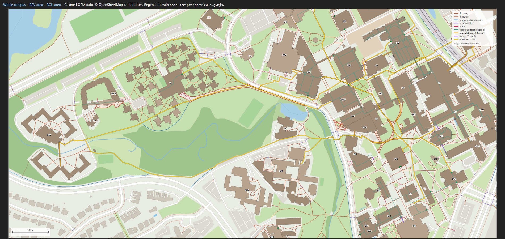

# UW Campus 3D: Phase 1 plan

Status: data spike done, waiting for your go-ahead before any app code is written.

**Short version:** the OpenStreetMap data is good enough to build all of Phase 1 without the UW API. The footpath network around REV and RCH is fully connected, a throwaway router already finds a sensible REV to RCH route (1,156 m, about 15 minutes), and OSM even has part of the tunnel and skywalk network tagged, which de-risks Phase 2. Four things need your input; they are listed at the end and none of them blocks the first slices.



Yellow is the spike router's output for several test pairs, including REV to RCH (the line from REV on the left, past Health Services, across Ring Road, to RCH on the right). To browse the whole map, open `docs/data-preview.svg` in a browser, or run `npx http-server docs` and use the links at the top.

---

## 1. Data quality report

Source: one Overpass fetch on 2026-11-12, window 43.463..43.479 N, 80.560..80.533 W (Ring Road, REV/V1/MKV, the colleges, East Campus, UW Place, north to Columbia Icefield and the research park edge). Raw response and cleaned GeoJSON are both in the repo.

### Buildings

| | Count |
|---|---|
| Buildings in the window | 1,069 |
| On campus (inside the UW boundary, or carrying a UW code) | 178 |
| ...with a building code | 68 |
| ...with a name | 122 |
| ...unnamed | 56 (only 7 are larger than 300 m²; the rest are sheds, canopies, small annexes) |
| Off-campus context (houses, plaza, apartments) | 891 |

Heights for the 178 campus buildings:

| Source | Count | Notes |
|---|---|---|
| Real `height` tag | 5 | EV1, EV2, EV3, SCH, TC |
| From `building:levels` | 104 | 4.0 m per level, 3.2 m for residences |
| Default guess by building type | 69 | includes PAC, HH, PAS, OPT, BMH, CIF, REN, STJ |

Every estimated campus building is listed in `data/reports/height-estimates.csv`, biggest guesses first. Corrections go in `data/overrides.json` and survive a re-fetch.

Better than expected: 44 buildings (most of the academic core, including MC, DC, SLC, PAC, QNC, E2, E3, LIB) also have OSM "building parts", 226 in total, with their own level counts. Those give real massing rather than one flat box. Example: Dana Porter Library's outline says 2 levels, but its parts describe a podium plus a 10-level tower. I will render parts wherever they cover the outline.

### Entrances

- 278 entrance nodes, 31 tagged as the main entrance. 72 campus buildings have at least one. RCH has 9, MC 8, SLC 10.
- 15 coded buildings have none mapped: REN, BRH, LHI, UWP, TJB, RAC, RA2, TH, CGR, STJ (two buildings), CSB, EC4, EC5, AVR. For these the door is placed where the outline comes closest to the path network. All 15 end up within 25 m of a path.

### Path network

- 2,973 `highway` ways. 2,549 are usable for Phase 1 walking (outdoor paths, sidewalks, crossings, steps, shared cycle paths, service roads and quiet streets). That is 164 km of walkable network.
- **Connectivity: 98.8% of it by length is one connected component.** The other 35 components are fragments of 190 m or less (isolated bits of sidewalk at the window edge, a few unconnected stubs).
- REV and RCH are both on the main component, with mapped entrances sitting directly on footpath nodes.
- 135 of 136 campus buildings checked can reach the main network. The exception is the Mackenzie King Village link building, whose nearest path is one of the fragments. The real graph builder will only attach doors to the main component, which fixes it.
- Busy roads (Ring Road, University Ave, Columbia St) are excluded as walking surfaces. Routes use their sidewalks and the 170 mapped crossings.

### Sample routes from the spike router

Shortest path, any public entrance to any public entrance, 1.3 m/s.

| From | To | Distance | Time | Straight line (centre to centre) |
|---|---|---|---|---|
| REV | RCH | 1,156 m | 14.8 min | 1,092 m |
| MC | E7 | 446 m | 5.7 min | 366 m |
| DC | SLC | 277 m | 3.5 min | 261 m |
| V1 | QNC | 471 m | 6.0 min | 482 m |
| REV | MC | 918 m | 11.8 min | 858 m |
| SLC | E5 | 427 m | 5.5 min | 438 m |
| CIF | SCH | 1,092 m | 14.0 min | 962 m |
| OPT | HH | 991 m | 12.7 min | 921 m |
| UWP | DC | 698 m | 8.9 min | 620 m |
| STJ | E2 | 461 m | 5.9 min | 512 m |
| MKV | PAC | 714 m | 9.1 min | 487 m |
| EC4 | LIB | 823 m | 10.6 min | 604 m |

All plausible. I looked at the REV to RCH line on the map: it leaves REV's central building, follows the shared path along the creek past Health Services, crosses Ring Road at the mapped crossing near Needles Hall, and comes into RCH from the west, between Physics and the library. That reads like a real student route.

### Indoor data already in OSM (for Phase 2)

Not used in Phase 1, but classified and kept: 239 indoor corridor ways with floor levels, 13 enclosed skywalk bridges (MC to QNC, E2 to E3, E5 and E6 bridges, and others), 6 tunnel ways (EV1 to HH, RCH to E2, RCH to DWE, and others), 8 elevators. This is partial coverage of the real network, not the whole thing, but it means Phase 2 starts from surveyed geometry rather than a blank page.

### Data problems found

1. **E7 does not exist in OSM under that name.** The building is tagged "Pearl Sullivan Engineering Building", code PSE, with `old_ref=E7`. Search will accept both; old codes become aliases automatically.
2. **REV is three separate outlines** (central complex plus a north pair and a south pair of quads), and nothing in OSM says which quad is "West". See question 1.
3. **V1's houses are named just "North 1", "South 3", "East 2"** and so on. They need a "V1" prefix in labels and search so they are not ambiguous.
4. **Six codes are mine, not OSM's:** M3, RAC, RA2, TJB, AVR, BRH. I added them from memory to `data/overrides.json`. Please check them.
5. **No ground elevation.** OSM has none, so Phase 1 ground is flat. Campus has real slopes (the hill down to Laurel Creek, the drop behind REV). Steps are drawn as paths with a step texture. Terrain could come later from Ontario's public LiDAR elevation data if it matters to you.
6. **Eight paths pass through buildings** (`tunnel=building_passage`). Only one is on UW property (through UW Place); the rest are in the apartment blocks and plaza to the north-east. Each needs an opening in the building's collider so the player can walk through; handled in the polish slice.
7. 855 of the off-campus context buildings have default heights (houses at 6.5 m). Fine for backdrop.

---

## 2. Architecture

### Data pipeline (offline, deterministic)

```
scripts/fetch-osm.mjs      Overpass  -> data/raw/osm-overpass.json          (run rarely)
scripts/build-geojson.mjs  raw + data/overrides.json -> data/geojson/*.geojson   (cleaned, WGS84, classified)
scripts/bake.ts            geojson -> public/data/campus.json               (projected to metres, graph built)
scripts/preview-svg.mjs    geojson -> docs/*.svg                            (2D check map)
```

The first two exist now. `bake` is new work: it projects everything to the local frame (origin 43.4715 N, 80.5445 W, x east, z south in Three.js terms, 1 unit = 1 m), builds the route graph, attaches doors, cuts building passages, and writes one compact file the app loads at startup. The app never touches Overpass. The bake step imports the same TypeScript graph code the app and the tests use, so there is one graph implementation.

### App

Vite 8, TypeScript, React 19, three 0.187, React Three Fiber 9, drei 10, `@react-three/rapier` 2.2, zustand for state, Vitest for unit tests, Playwright for screenshots. All versions checked against npm today and mutually compatible.

```
src/
  data/        load + types for campus.json
  routing/     graph types, builder, A*, cost profiles, place search      (pure TS, no three.js, unit tested)
  scene/       Ground, Buildings, Paths, Trees, Lighting, Labels, RouteLine
  player/      character controller, third-person camera
  flythrough/  route -> camera curve, playback controller
  map/         top-down camera mode
  ui/          search, route card, flythrough controls, attribution
  state/       zustand store: mode (walk | map | fly), route, selection
```

**Rendering.** All static geometry is merged into a small number of meshes at load: one for buildings (walls and roofs, vertex colours for per-building variation), one per ground material (grass, water, parking, plazas), one per path type (roads and paths as flat ribbons), trees as a single instanced mesh (1,698 mapped trees). Target is under 40 draw calls and roughly 400k triangles, which should hold 60 fps on integrated graphics. Building picking uses a triangle-range lookup on the merged mesh, so merging does not cost us click-to-select.

**Look.** Architectural-model style: warm off-white and brick-toned buildings with slight per-building tint variation (seeded by building id, nudged by OSM `building:colour` where present), muted greens, pale paths. One sun with a soft shadow map that follows the camera (a 2 km campus is too big for one static shadow map), hemisphere fill light, light distance fog. Ambient occlusion as an optional quality setting if frame rate allows.

**Labels.** HTML overlay rather than in-scene text: crisp at any distance and cheap for about 70 coded buildings. Code only when far, code plus name when near, greedy overlap culling with priority by footprint size and distance, fade rather than pop.

**Walking.** Rapier kinematic character controller with a capsule, WASD plus shift to run, pointer-lock mouse look, third-person camera with a spring arm that shortens when a building is between camera and player. Building collision is a single static triangle-mesh collider made from wall faces only (roofs and canopies excluded, passage openings cut). Ground is a flat collider.

**Routing.** Described in section 3. Start and destination can be a building (search by code, old code, or name; click on the building), a room string such as "RCH 101" (parsed to building RCH, room kept for Phase 3), a clicked map point, or the player's current position.

**Flythrough.** Route polyline is simplified, smoothed with a centripetal Catmull-Rom curve, and re-parametrised by arc length. The camera rides about 14 m up and 20 m behind a look-ahead target, cruising near 18 m/s, slowing into sharp turns and easing in and out at the ends, then settling into a short orbit facing the destination entrance. If a building would block the view the camera rises over it. Space pauses, a scrubber seeks, Esc or any movement key hands control back, and "walk from here" drops the player on the route at the current point.

**Map mode.** Orthographic top-down camera with pan and zoom, same scene, same route line, labels switch to a denser setting.

### Testing and verification

- Vitest: projection round trip, graph construction on a small hand-built fixture, A* against brute force on the fixture, cost profiles, place search and aliases.
- Data tests over the real baked graph: every coded building can reach every other; REV to RCH stays within 1.05 to 1.35 km; the five other pairs in the brief stay within a sane ratio of straight-line distance.
- A Phase 2 readiness test: a fixture with a tunnel edge, proving that "outdoor" ignores it, "prefer indoor" takes it, and "indoor only" fails cleanly when no indoor path exists.
- Playwright script that loads the app and saves screenshots of the campus overview, REV, RCH, a drawn route, and a flythrough frame. I look at them before calling a slice done.

---

## 3. Route graph data model

The graph is built once at bake time and shipped as data. It is designed around one idea: **a route mode is a cost function, not a different graph.**

```ts
interface GraphNode {
  id: number;
  x: number; y: number;        // metres, local frame
  level: number;               // floor: 0 ground, -1 tunnel level, 1, 2 ... Phase 1 is all 0
  kind: 'junction' | 'door' | 'crossing' | 'stairs' | 'elevator';
  building?: string;           // set on doors and on indoor nodes
}

type EdgeKind =
  | 'footway' | 'sidewalk' | 'path' | 'plaza' | 'steps' | 'crossing'   // Phase 1
  | 'service' | 'street' | 'connector' | 'door'                        // Phase 1
  | 'tunnel' | 'skywalk' | 'corridor' | 'stairs' | 'elevator';         // Phase 2

interface GraphEdge {
  id: number;
  a: number; b: number;        // node ids, undirected
  length: number;              // metres along the geometry
  kind: EdgeKind;
  env: 'outdoor' | 'covered' | 'indoor';
  level: number;               // floor the edge runs on; stairs and elevators carry levelTo as well
  levelTo?: number;
  penalty?: number;            // fixed seconds: waiting at a crossing, opening a door, an elevator ride
  accessible?: boolean;        // step-free, for a later accessibility mode
  building?: string;           // indoor edges: which building you are inside
  name?: string;               // "MC to QNC Walkway"
  geometry: number[];          // polyline [x, y, x, y, ...] for drawing and for the camera path
  source: 'osm' | 'manual';    // manual = hand-added in data/network-extra.geojson
}

interface RouteProfile {
  name: 'outdoor' | 'preferIndoor' | 'indoorOnly';
  speed: number;                                   // 1.3 m/s
  cost(edge: GraphEdge): number;                   // seconds, Infinity = not allowed
}
```

How Phase 1 uses it: every edge has `env: 'outdoor'` or `'covered'` and `level: 0`. The `outdoor` profile is `length / speed * kindFactor + penalty`, where steps and service roads cost a little more than footpaths, and each road crossing adds a few seconds.

How tunnels, bridges and floors slot in later:

- **Tunnels, skywalks, corridors** become ordinary edges with `env: 'indoor'` and their floor in `level`. The cleaning step already classifies OSM's indoor ways this way; Phase 1 simply does not put them in the graph.
- **Floors.** Node identity is (position, level). A tunnel passing under a footpath shares x and y with it but is a different node, so there are no accidental connections. Moving between floors only happens on explicit `stairs` or `elevator` edges, which connect two nodes at the same position on different levels.
- **Doors** are the only link between outdoor and indoor: a `door` edge from the level-0 outdoor node at an entrance to the indoor node just inside.
- **Route modes** are new profiles and nothing else. `preferIndoor` multiplies outdoor edge cost (say by 3, tunable). `indoorOnly` returns Infinity for outdoor edges, optionally allowing short outdoor dashes under a set length. No graph rebuild, no router change.
- **Missing connections.** OSM's tunnel coverage is partial, and the brief says not to invent any. Phase 2 adds `data/network-extra.geojson`: hand-drawn lines with the same properties, traced from the official UW tunnel map and marked `source: 'manual'`, merged at bake time.
- **Rooms.** A place is `{ building, room?, node? }`. In Phase 1 "RCH 101" resolves to RCH's entrance. In Phase 3 a rooms table points it at an indoor node on the right floor and routing carries on unchanged.
- **Rendering by level.** Because edges carry level and env, the route line can be drawn dashed or tinted for underground and elevated stretches, and the flythrough camera can decide to drop inside or stay above.

---

## 4. Build order after approval

Each slice ends with tests passing, screenshots reviewed, `PROGRESS.md` updated and a commit.

1. **Scaffold and bake.** Vite project, bake script, typed loader, Vitest wired up. Empty scene with a camera you can orbit.
2. **Ground and buildings.** Areas, roads, paths, extruded buildings with parts, trees, lighting, labels, attribution. Compare against OSM side by side.
3. **Walking.** Character, collision, third-person camera, spawn at REV.
4. **Routing.** Graph module with tests, search UI, click to pick, route line, distance and time card, map mode.
5. **Flythrough.** Camera path, playback controls, hand-back to walking.
6. **Polish.** Visual pass, performance pass, label tuning, passage openings, final report.

---

## 5. Risks and trade-offs

- **Frame rate with shadows.** A full-campus soft shadow pass is the most likely thing to cost us 60 fps on a laptop. Mitigation: camera-following shadow frustum, static geometry, a quality toggle. I will measure and tell you what was traded.
- **Flat ground** makes steps and the creek valley look less real than they are. Accepted for Phase 1 unless you say otherwise.
- **Plazas.** OSM models open squares as outlines, so a route can hug the edge of a plaza instead of cutting across. I will add crossing edges through pedestrian areas at bake time.
- **Entrance choice** changes how routes look; see question 2.
- **OSM is a snapshot.** Construction around M4 and the east side is mapped as construction and excluded. Re-running the fetch later picks up changes; overrides are keyed by OSM id and survive.

---

## 6. Questions for you

1. **Which REV building is West Quad?** In `docs/screenshots/spike-rev.png` the central building is labelled REV, with two U-shaped wings above it and two below. My guess is the upper-left wing (the westernmost one). Until you confirm, "REV West Quad" spawns at that wing's courtyard door.
2. **Which entrance should a route end at?** The brief says a room resolves to the building's main entrance. Only 31 buildings have one tagged, and for big buildings the main door can be on the far side from where you arrive. My recommendation: route to whichever public entrance is fastest to reach, say which one in the route card, and allow a pinned entrance per building or room in the overrides file (so RCH 101 can be pinned to the right door once you know it). Say so if you would rather always use the main entrance.
3. **Flat ground for Phase 1: acceptable?** Adding terrain is a contained piece of work but touches everything that sits on the ground, so it is cheaper to decide early.
4. **Context7 is not authorised in this session**, so I cannot check library docs through it as the brief asks. You can authorise it with `/mcp`. Otherwise I will read the official docs for three, R3F, drei and Rapier on the web, which works fine.

No API key is needed: OSM covers the building codes, so I do not plan to use the UW Open Data API.
