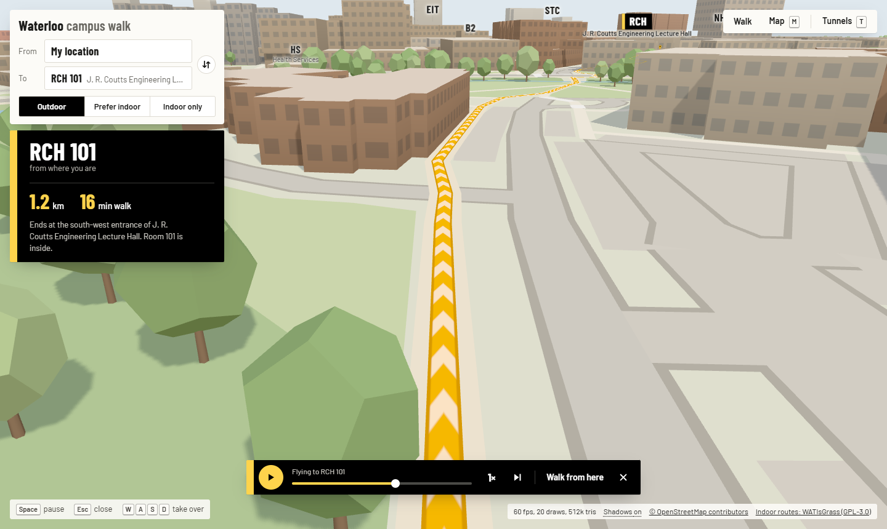

# ThruLoo

A 3D model of the University of Waterloo main campus that runs in the browser. Walk around it in third person, search for any building, see the fastest walking route with its distance and time, and watch a camera fly the route so you know exactly how to get there.

Routes can stay outside, prefer the tunnels and bridges, or stay indoors the whole way, with step-by-step directions (which floor, which tunnel). You can walk those routes yourself: go in through a door, along the hallways, down the stairs, through the tunnels and across the bridges, while the buildings are cut away around you. The indoor network comes from [WATIsGrass](https://github.com/rickyqin005/WATIsGrass) by Ricky Qin and Manasva Katyal.



## Run it

Needs Node 20 or newer.

```bash
npm install
```

```bash
npm run dev
```

Then open http://localhost:5173. The campus data is checked in, so nothing else is needed.

## Use it

| | |
|---|---|
| Walk | `W` `A` `S` `D` or arrow keys |
| Run | hold `Shift` |
| Jump | `Space` (outdoors) |
| Tunnels and bridges | walk into a doorway that leads to one. Turn on the tunnel map (`T`) to see where they are. Walk back out the same way. Only hallways and stairs that lead somewhere are kept: for rooms, use the indoor map |
| Stuck in a wall | a "Stuck? Tap to get out" button appears and puts you on the nearest path |
| Stairs | at a stairwell, `E` goes up and `Q` goes down. The prompt says where each leads and marks the one your route takes |
| Look | click the scene to capture the mouse (`Esc` releases it), or drag |
| Zoom the camera | mouse wheel |
| Map view | `M`, or the switch at the top right. Drag to pan, scroll to zoom, click a building or the ground to pick it |
| Search | click From or To (or press `/`) and type a code (`MC`), an old code (`E7`), a name (`davis`) or a room (`RCH 101`) |
| Route type | Outdoor, Prefer indoor or Indoor only, under the From and To fields. If two places are not joined indoors, Indoor only shows the route with the least time outside and says so |
| Tunnel map | `T`, or "Tunnels" at the top right, draws every tunnel, bridge and hallway through the buildings |
| Flythrough | "Show me" on the route sign. `Space` pauses, the slider scrubs, `Esc` closes, and any movement key hands control back. Where the route goes through a tunnel, hallway or bridge the camera drops to head height and slows to a walk |
| Get there | "Start" on the route sign follows your live location along the route: no joystick, your character walks where you walk. The banner on top says the step you are on (tap it for the whole list, with where you are marked), the bar at the bottom says how far is left, switches between the view behind you and an overhead map (`M`), and ends it. Step off the route and a new one is planned from where you are |
| Live location | "Locate" at the top right, or the crosshair button on a phone. Your character walks wherever you walk and keeps to your route when you are near it. A position that lands inside a building is moved onto the nearest hallway or tunnel of that building, or else the nearest outdoor path, so you are never stuck in a wall. Moving the character yourself pauses following; tap the button again to go back to where you are |

### On a phone

Phones and small tablets get their own layout: a "Where to?" bar on top, the route in a sheet along the bottom (tap it for the step-by-step directions), and round buttons for live location, tunnels and the map. Walk with the joystick bottom left (a small push walks slowly, push to the edge to run), drag anywhere else to look, pinch to zoom. Stairs prompts are buttons. Shadows start off and the scene renders at a lower pixel ratio to keep the frame rate up; the whole download is about 1.7 MB compressed (1.2 MB of code, 0.5 MB of campus data), once.

Browsers only share location with pages served over **https** (or `localhost`), so to try live location on a phone, deploy the build somewhere with https, or tunnel the dev server (for example `npx vite --host` behind an https tunnel). Over plain http on a LAN address the app says so instead.

A route can be shared as a link: `/?from=MC&to=RCH%20101&route=indoor&view=map`. `route` is `indoor` or `prefer` (leave it out for outdoor). Add `&tunnels` to show the network, `&fly=1` to start the flythrough and `&debug` for a frame-rate readout.

## Commands

| | |
|---|---|
| `npm run dev` | Development server |
| `npm test` | Unit tests and data tests (routing, graph building, indoor import, indoor walking, flythrough path, real campus routes) |
| `npm run build` | Type-check and build to `dist/` |
| `npm run shots` | With the dev server running: drive the app in a browser, check the main flows, save screenshots to `docs/screenshots/` |
| `npm run data` | Rebuild `data/geojson/` and `public/data/campus.json` from the saved OSM response and `data/overrides.json` |
| `npm run data:fetch` | Re-download from Overpass (rarely needed), then run `npm run data` |

## Correcting the data

Everything above ground comes from OpenStreetMap. The indoor network is in `data/indoor/` (see the README there for its source, licence and how to update it). Hand corrections to the OSM data live in `data/overrides.json` and survive a re-fetch:

- **Heights.** `data/reports/height-estimates.csv` lists every campus building whose height is an estimate. Add `"way/123": { "height": 24 }` under `buildings`, then `npm run data`.
- **Codes, names, aliases.** Same place: `{ "code": "M3", "name": "...", "aliases": ["..."] }`.
- **Named places** such as "REV West Quad" are under `places`, with a latitude and longitude.

`node scripts/preview-svg.mjs` draws the cleaned data as a flat map in `docs/data-preview.svg` for comparing against OSM or satellite imagery.

## How it is put together

```
scripts/fetch-osm.mjs      Overpass -> data/raw/osm-overpass.json
scripts/build-geojson.mjs  raw + overrides -> data/geojson/*.geojson (cleaned, classified)
scripts/bake.ts            geojson + data/indoor -> public/data/campus.json (local metres, route graph, doors)


src/routing/     graph builder, indoor import, A* search, cost profiles, place search (pure TypeScript, tested)
src/indoor/      where the character can stand indoors: hallways, tunnels, bridges, doorways, stairs (pure TypeScript, tested)
src/flythrough/  route -> camera path
src/scene/       ground, buildings, trees, light, labels, player, cameras, route line
src/ui/          search, route sign, flythrough bar, hints
src/state/       app state (zustand) and per-frame state
```

See `PLAN.md` for the design, `DECISIONS.md` for choices that differ from the brief, `REPORT.md` for what was verified and what is missing, and `PROGRESS.md` for where things stand.

## Licence and credits

ThruLoo is free software under the **GNU General Public License v3.0 only**: see [LICENSE](LICENSE) and [NOTICE.md](NOTICE.md) (what came from where, and what was changed).

- Indoor and tunnel routing data: [WATIsGrass](https://github.com/rickyqin005/WATIsGrass) by Ricky Qin and Manasva Katyal, licensed under the GNU GPL v3.0. The two data files are kept unchanged in `data/indoor/watisgrass/` with their licence; the app's route graph is generated from them. See `data/indoor/README.md`.
- Map data © [OpenStreetMap contributors](https://www.openstreetmap.org/copyright), Open Database License (ODbL).
- Fonts: Barlow and Barlow Condensed, SIL Open Font License 1.1.
- ThruLoo is an independent student project, not affiliated with or endorsed by the University of Waterloo.
- This repository contains no University of Waterloo copyrighted material (no floor plans, official maps or scraped university pages).
