# Phase 1 report

Written 2026-11-13 for someone who has not watched the work. `README.md` covers running and using the app.

## What was built

A browser app that models the University of Waterloo main campus in 3D from OpenStreetMap data and does the two things the brief asked for.

**Walk around.** All 1,069 buildings in the fetch window (178 on campus) are extruded from real footprints at estimated heights; 41 core buildings use OSM's detailed 3D parts, so the library has its tower and MC its stepped massing. Roads, footpaths, grass, woods, water, parking and plazas are drawn from map data, with the 1,697 trees OSM has mapped individually plus generated trees filling the woodland areas. You control a third-person character with WASD, shift to run and mouse look, and you cannot walk through buildings. You start at REV.

**Find and preview a route.** Search by building code, old code, name or room. The app computes the fastest walking route over the real footpath network, draws it on the ground, and shows distance and time at 1.3 m/s. "Show me" flies a camera along the route and ends at the destination entrance; it can be paused, scrubbed, sped up, skipped and exited at any moment, including by just pressing a movement key. A top-down map view shows the whole route at a glance and lets you pick places by clicking.

| | |
|---|---|
| 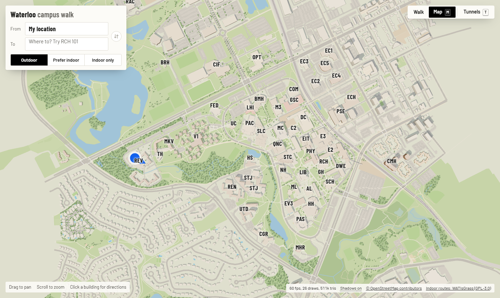 | 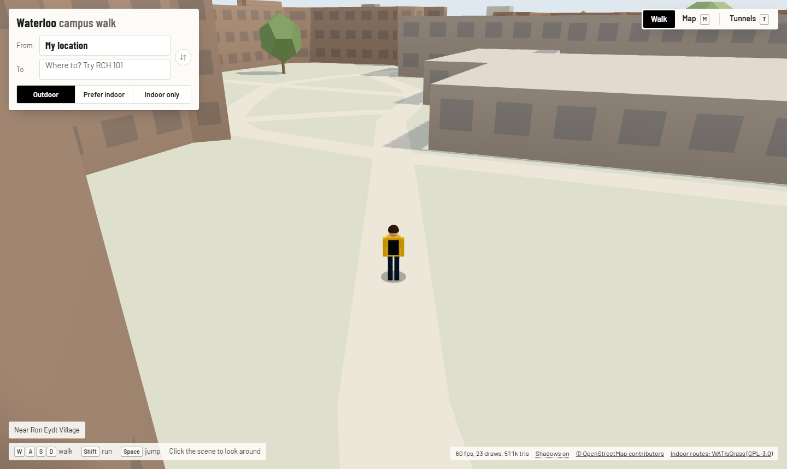 |
| Whole campus, map view | Start point at REV |
| 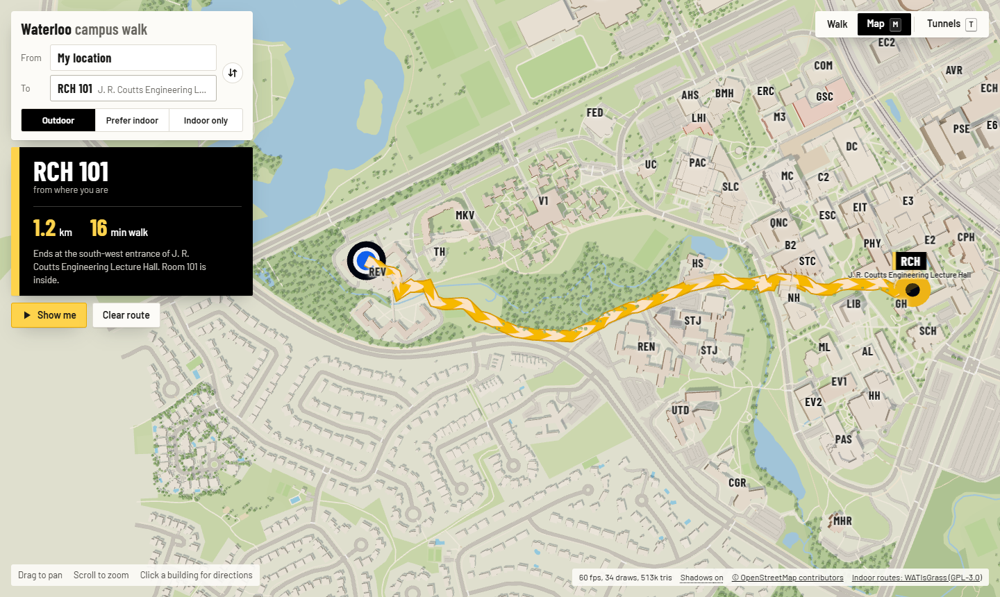 | 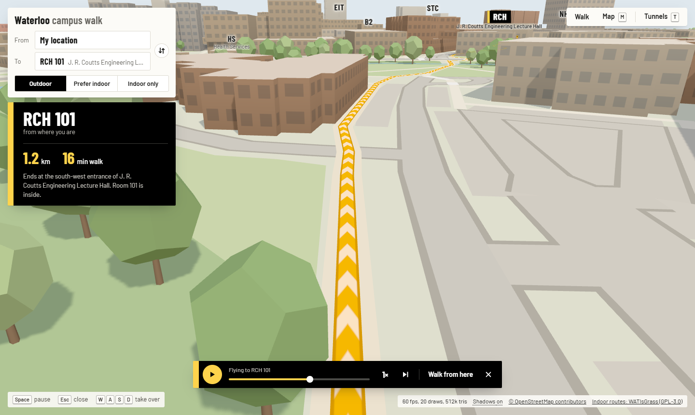 |
| REV West Quad to RCH 101 on the map | A frame from the flythrough |
| 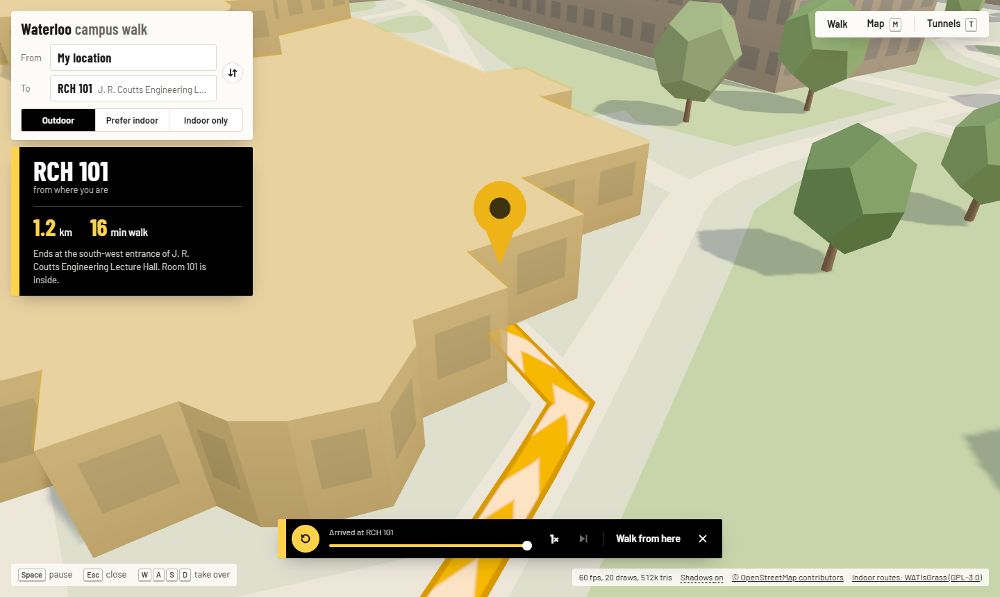 | 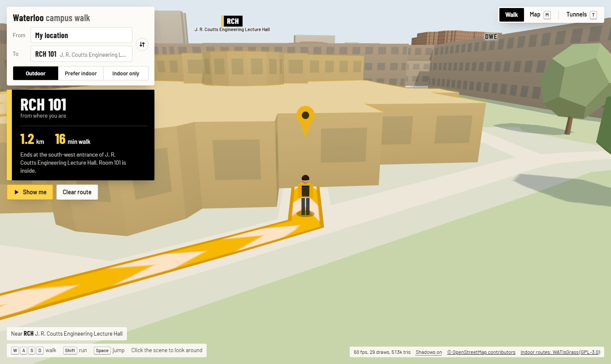 |
| The flythrough arriving at RCH | Standing at the RCH entrance after "Walk from here" |

More in `docs/screenshots/`: the search box, the route from walking height, and five other routes (`route-mc-e7.png`, `route-dc-slc.png`, `route-v1-qnc.png`, `route-slc-e5.png`, `route-cif-sch.png`).

## The test case: REV West Quad to RCH 101

**1.25 km, 16 minutes** from the West Quad door (1.24 km from the spot a few metres away where you spawn). The route leaves the REV courtyard, follows the shared path along Laurel Creek past Health Services, crosses Ring Road at the mapped crossing by Needles Hall, passes the science buildings and ends at RCH's south-west entrance. About 100 m (8%) is along a service road near REV; the rest is paths, sidewalks and crossings.

Other pairs from the brief, door to door:

| From | To | Distance | Time |
|---|---|---|---|
| MC | E7 (PSE) | 430 m | 5.5 min |
| DC | SLC | 270 m | 3.5 min |
| V1 | QNC | 470 m | 6.1 min |
| SLC | E5 | 430 m | 5.5 min |
| CIF | SCH | 1.09 km | 14.1 min |

## What was verified, and how

| Brief criterion | How it was checked | Result |
|---|---|---|
| Spawn at REV West Quad, walk to RCH, no clipping | A script held the run key and steered the real character along the route in the browser, under the real collision code, sampling its position every frame against every building footprint. | Arrived 0.7 m from the route's end at RCH after 163 s. 22 of 8,928 frames were inside a footprint, all at STC where the mapped path itself runs under the building (see known gaps). |
| Positions and shapes match OSM | `scripts/preview-svg.mjs` renders the cleaned data as a flat map; I compared it and the app's map view by eye against OSM's rendering of campus. | Footprints, paths and layout match. I did not compare against satellite imagery. |
| REV to RCH follows real paths, plausible distance and time | Unit test bounds (1.05 to 1.4 km, 13 to 19 min, under 20% roadway) plus reading the route on the map. | 1.25 km, 16.1 min, 8% service road, passes. |
| Five other pairs look sensible | Eight pairs are tested for directness (within 1.6x straight-line plus 150 m), symmetry, and for invented edges staying out of buildings. Five were also screenshotted and looked at. | All pass. |
| Flythrough smooth, readable, ends at the entrance | Unit tests on the camera path: forward motion only, no per-frame jumps or snaps, slows for corners, climbs over buildings, ends looking at the destination. Then watched frames at the start, middle and arrival. | Passes; arrival frame shows the pin on the RCH entrance. |
| Fresh clone, `npm install`, `npm run dev` | Cloned the repository to a temporary folder, ran `npm install`, `npm test`, `npm run build`, and started the dev server. | Works. |

Automated checks in the repository:

- **46 tests** (`npm test`): graph construction on hand-built fixtures, A* against brute-force shortest paths on a random graph, door snapping, plaza crossings, crossing penalties, floor separation, the three route modes on a fixture with a tunnel, place search, the flythrough path, and the real campus data (every coded building has a door and can reach every other).
- **`npm run shots`**: drives the real app with real typing and clicks (search, pick, map, Show me, pause, seek, Walk from here), fails on any console error, and saves the screenshots above.

**Performance.** About 55 frames a second in walk, map and flythrough, measured in an automated Chrome window at 1440x860 on this laptop's integrated GPU (Qualcomm Adreno X1-85) with shadows on. A frame is 20 to 42 draw calls and roughly 510,000 triangles including the shadow pass. Turning shadows off did not raise the number, which suggests it was limited by the display rather than the GPU. Not measured: full-screen on a high-density display, or other hardware. If it is slow there, "Shadows" at the bottom right is the first thing to turn off. Trade-offs made for speed: all static geometry is merged into a handful of meshes; trees are 36-triangle instanced shapes; the sun's shadow map follows the camera instead of covering the campus, so shadows stop about 170 m out in walk mode; materials are simple matte ones.

## Known gaps

**Data**

1. **Heights are mostly estimates.** Only 5 campus buildings have a surveyed height. 104 come from level counts and 69 are guesses by building type, including PAC, HH, PAS, OPT, BMH and CIF. `data/reports/height-estimates.csv` lists them; fixes go in `data/overrides.json`.
2. **"REV West Quad" is a guess.** OSM draws REV as a central building plus two pairs of wings and does not name the quads. The app uses the western wing of the northern pair. If that is wrong, change the place's coordinates in `data/overrides.json`.
3. **Six building codes are from my memory, not OSM:** M3, RAC, RA2, TJB, AVR, BRH. Please check them. E7 is tagged PSE (Pearl Sullivan Engineering) in OSM; both codes work in search.
4. **The ground is flat.** OSM has no elevation. The slopes around Laurel Creek and REV are missing and steps are drawn as flat paths.
5. **15 coded buildings have no entrance in OSM** (REN, BRH, LHI, UWP, TJB, RAC, RA2, TH, CGR, both STJ buildings, CSB, EC4, EC5, AVR). Their door is placed where the outline is closest to a path, which may not be the real door.
6. **A few entrances are mapped inside the footprint** (an atrium door at AHS, one at DC). Their last few metres of route cross a wall on the map. About 110 m of connector across the whole campus is affected.

**App**

7. **Walk-throughs under buildings.** Where a surveyed path runs through a building footprint (160 wall crossings, for example at PAS, EIT, STC and DC, which I take to be breezeways, arcades and overhangs), the collider has an opening so you can follow the route, but the building is still drawn solid, so you briefly walk through a wall. Cutting real openings into the meshes is the fix.
8. **Routes end at the fastest public entrance to reach,** not always the tagged main entrance, and a room such as RCH 101 resolves to its building. This was my recommendation in the plan; say if you would rather always use main entrances.
9. **"My location" is a snapshot.** A route from where you stand does not update as you walk; pick the destination again to refresh it.
10. **Mouse capture was not exercised by the automated checks** (browsers refuse pointer lock to scripts). Dragging to look was. Please try clicking the scene yourself.
11. **No touch controls,** as agreed. Nothing in the design blocks them.
12. **Bundle size.** 3.5 MB of JavaScript (1.2 MB gzipped), about 2 MB of which is the Rapier physics engine, plus 2 MB of campus data. Fine locally; worth splitting before deploying.
13. **Context7 was not available** in these sessions. Library APIs were checked against the installed packages' own type definitions and source instead, which caught two real changes (three.js r187 removed the soft shadow map type; Rapier renamed ray hit fields).

Nothing is deployed, and no accounts or keys were needed.

## Recommendation for Phase 2: tunnels and bridges

The graph is ready: edges already carry `env` (outdoor, covered, indoor), `level`, and a `source`, and route modes are cost functions. `preferIndoor` and `indoorOnly` profiles exist and are tested on a fixture. The work is data and presentation.

1. **Start from what OSM has.** The saved fetch already contains 6 tunnel segments (EV1 to HH, RCH to E2, RCH to DWE and others), 13 enclosed bridges (MC to QNC, E2 to E3, the E5 and E6 bridges), 239 indoor corridor segments with floor levels and 8 elevators. `build-geojson.mjs` classifies them; `bake.ts` currently filters them out. Turn that filter into a level-aware import: indoor ways become edges at their floor, entrances become `door` edges between the outdoor node and the indoor node, and stairs and elevators become edges between levels.
2. **Fill the gaps by hand, visibly.** OSM's coverage is partial. Add `data/network-extra.geojson` for connections traced from the official UW tunnel and bridge map, each marked `source: 'manual'` so it is always clear which links were surveyed and which were drawn. I would not guess any; walk them or trace them from the official map.
3. **Use the simplest indoor model that routes correctly.** A full floor plan is not needed for "indoor only" routing. Treat each building as a small graph: one node per door, per tunnel or bridge mouth, and per stair or elevator, joined by corridor edges with realistic lengths. That is enough for correct distances and for the winter question "can I get from A to B without going outside?".
4. **Add the mode switch.** A three-way control on the route sign: Outdoor, Prefer indoor, Indoor only. When indoor-only fails, say which stretch has no indoor connection and offer the shortest route with the least time outside.
5. **Show levels.** Draw underground stretches dashed and elevated ones raised, fade building walls when the route goes inside, and let the flythrough camera drop into a cut-away view for tunnels. The route line already draws faintly through buildings, which is a workable first version.
6. **Test it like Phase 1.** A connectivity test for the indoor component (which buildings are reachable indoors from which), and pinned expectations for a few well-known winter routes.

Two things worth deciding before starting: whether to add terrain (it changes where tunnels surface and how steps look), and whether to cut real openings for walk-throughs (gap 7), since both touch the same building geometry that Phase 2 will open up.

---

# Phase 2 report: tunnels and bridges

Written 2026-11-13. Phase 2 took a shortcut the Phase 1 recommendation did not know about: the owner supplied the **WATIsGrass** repository, which already holds the campus's indoor network as georeferenced data. Nothing was hand-traced or guessed.

## What was added

- **The indoor network in the route graph.** From WATIsGrass: 96 hallways, 10 tunnels, 12 enclosed bridges, 53 stairwells and 43 doors to the outside, across 40 buildings, 5.05 km in total. All of it is connected to the outdoor paths: 38 exits were joined to an entrance OpenStreetMap already had for that building, 5 to the nearest path, none were dropped.
- **Three route types,** chosen under the From and To fields: Outdoor (Phase 1 behaviour, unchanged), Prefer indoor, and Indoor only. When two places are not joined indoors, Indoor only shows the route with the least time outside and says so, instead of showing nothing.
- **Directions.** Indoor routes list their steps: which door, which floor, which stairs, which tunnel or bridge, with distances, plus the split between indoors and outside and the floors climbed.
- **The tunnel map.** Press `T` (or "Tunnels") to draw every tunnel, bridge, hallway and stairwell through the buildings: tunnels in blue dipping below ground, bridges in teal at their floor, hallways in grey. It works in the map view and from the ground.
- **Indoor routes in 3D.** The route line runs at floor height inside buildings and shows through walls, so the flythrough of an indoor route stays readable from above.

| | |
|---|---|
| 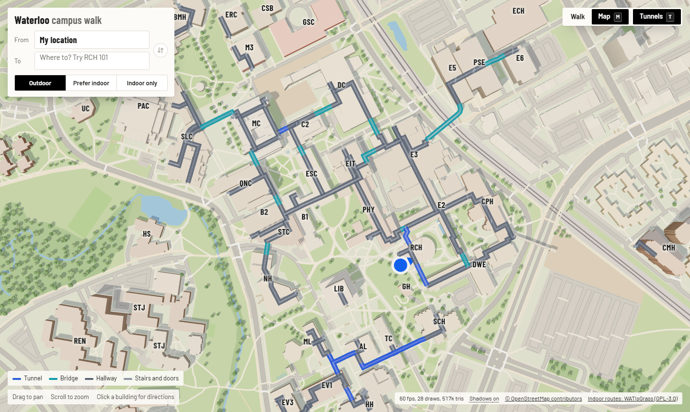 |  |
| The network: tunnels blue, bridges teal, hallways grey | MC to RCH 101, indoors all the way |
| 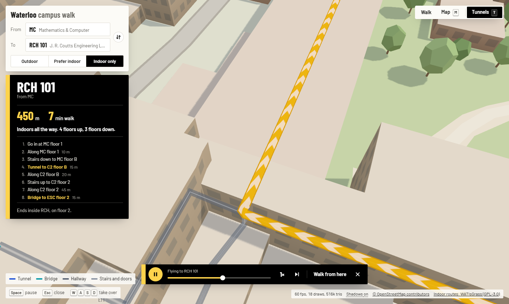 | 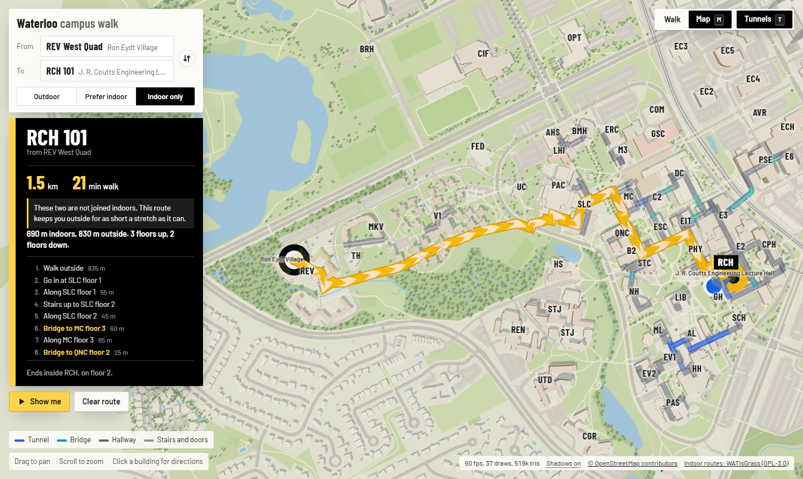 |
| The same route in the flythrough | REV to RCH: no fully indoor route, so the least time outside |
| 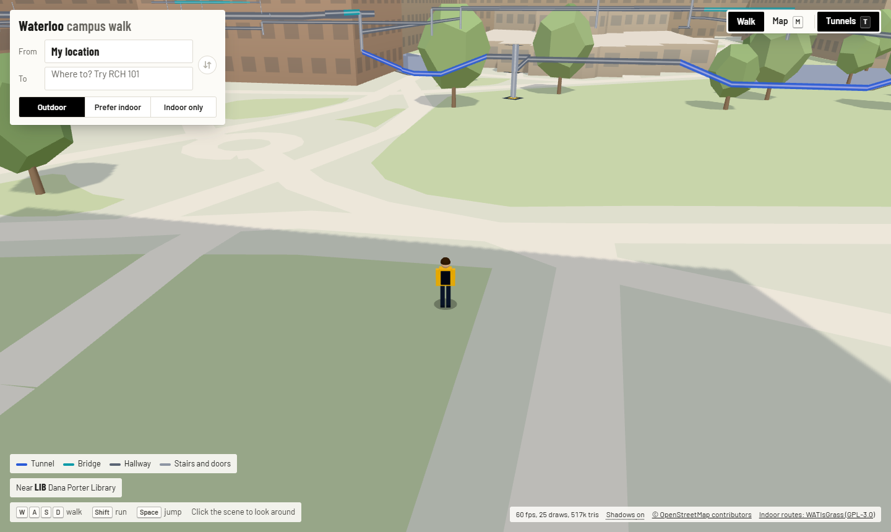 | |
| The network seen while walking | |

## What the network covers

Buildings joined to each other without going outside:

- **Main cluster, 21 buildings:** B1, B2, C2, CPH, DC, DWE, E2, E3, E5, E6, E7, EIT, ESC, MC, NH, PAC, PHY, QNC, RCH, SLC, STC.
- **South cluster, 8 buildings:** AL, EV1, EV2, EV3, HH, ML, SCH, TC.
- **BMH and EXP** (the AHS expansion) are joined to each other only.
- **On their own,** with hallways and doors but no indoor link to another building: PAS, DP (the library), ERC, M3, OPT, V1, MKV, CMH. REV has only an entrance in the data.

So "indoor only" works within a cluster, and the residences are not in one. REV to RCH has no fully indoor route.

## Results

| Route | Outdoor | Indoor only |
|---|---|---|
| MC to RCH 101 | 306 m, 3.9 min | 446 m, 7.3 min, 0 m outside, 2 tunnels and 2 bridges |
| MC to DC | 127 m, 1.6 min | 162 m, 3.0 min, 0 m outside, 1 tunnel and 1 bridge |
| PAC to E3 | 532 m, 6.8 min | 673 m, 9.3 min, 0 m outside |
| EV1 to SCH | 217 m, 2.8 min | 276 m, 3.6 min, 0 m outside, 2 tunnels |
| REV West Quad to RCH 101 | 1.25 km, 16.1 min | none; least time outside is 1.53 km, 20.8 min, 835 m outside instead of 1,250 m |

Indoor routes are longer and slower than walking straight across, mostly because of stairs (14 seconds a floor). That is the real trade in winter.

## What was verified, and how

- **69 tests pass** (`npm test`), 23 of them new: the importer on a hand-built fixture (floor heights, tunnel shape, stairs cost, exits joined, dead pieces dropped), the three route types on that fixture, and the real campus (all 10 tunnels and 12 bridges present, tunnels below ground and bridges above it, six building pairs walkable entirely indoors, REV to RCH correctly has no indoor route and its fallback spends less time outside, prefer-indoor never spends more time outside than outdoor).
- **Outdoor routing is unchanged.** Every Phase 1 route test still passes with the same distances (REV West Quad to RCH 101 is still 1.25 km).
- **`npm run shots` drives the new controls for real:** presses `T`, types MC and RCH 101, clicks "Indoor only", checks the route has 0 m outside and 17 steps, flies it, then switches the start to REV and checks the fallback warning appears. No console errors.
- **I looked at each screenshot above.** The network sits inside the right buildings on the map, the tunnels I could cross-check against OSM's own tunnel tags (RCH to E2, RCH to DWE, EV1 to HH) are in the same places, and the indoor route's steps match its line.
- **Frame rate** is still about 60 a second with the network shown (24 draw calls), so there was no need to cut the surrounding city.

Not verified: the indoor data against the real buildings. I checked that it is self-consistent and lines up with the footprints, not that every hallway and door exists as drawn. That accuracy is WATIsGrass's.

## Known gaps

1. **You cannot walk the character through the tunnels.** Buildings are still solid shells. Indoor routes are shown, described and flown, not walked. "Walk from here" during an indoor stretch puts you on the nearest outdoor path.
2. **Floor heights are approximate.** WATIsGrass gives relative heights within each stairwell; I spread those across connected buildings and pin floors with outside doors to ground level. Because the real campus slopes and this one is flat, 12 of the relations disagree and a few floors sit half a storey off. Routing is unaffected; only how high a line is drawn.
3. **Hallways are schematic.** They are centre lines, sometimes simplified, so a hallway can look like it clips a wall on the map.
4. **No elevators** in the data, so there is no step-free route type yet.
5. **Indoor routes start and end at a point on the right building's hallways, not at a room.** "RCH 101" ends inside RCH on whichever floor the route reaches first.
6. **"Prefer indoor" is a single weighting** (outside costs three times as much as inside). It can be tuned in `src/state/store.ts`.
7. **The data is a snapshot** of WATIsGrass as downloaded. `data/indoor/README.md` says how to refresh it.

## Licence: decide before publishing

WATIsGrass is licensed **GPL-3.0**, and its data is now part of this project (`data/indoor/watisgrass/`, and baked into `public/data/campus.json`). Running it yourself carries no obligations. Publishing the repository or deploying the site does: the data and what is derived from it must stay GPL-3.0 with credit, and the cautious reading is that the whole project should then be GPL-3.0 too, unless the WATIsGrass authors agree to other terms. The app credits them at the bottom right. This is my plain reading, not legal advice; `data/indoor/README.md` has the details.

## Suggested next steps

1. **Walkable interiors for the tunnels and bridges themselves.** Done; see the next section.
2. **Terrain.** It would fix the floor-height mismatches and make tunnels surface where they really do.
3. **Rooms.** With a floor known for each hallway, a room number can already pick the right floor; a small table of room positions would finish the job for the lecture halls that matter most.

---

# Walkable tunnels report

Written 2026-11-13. Gap 1 of the Phase 2 report ("you cannot walk the character through the tunnels") is closed.

## What was added

- **You can go indoors.** Walk into a doorway of any building that has hallways mapped and the character carries on inside, along the hallways, through the tunnels and across the bridges. Walk back out through a doorway the same way.
- **Stairs.** At a stairwell a prompt offers `E` to go up and `Q` to go down, says where each leads ("Stairs up to MC floor 3"), and marks the one your current route takes.
- **You can see what you are doing.** While the character is inside, the buildings are cut away in a circle around it (and stay solid further out), and the insides are drawn as real geometry: hallway floors with a dark outline, tunnels as open trenches below ground, bridges with railings, and a pad on each floor of a stairwell joined by a post. The location chip says "Inside MC floor 3", "In a tunnel" or "On a bridge".
- **Indoor routes can be walked,** not just flown. The gold route line lies on the hallway floor. "Walk from here" during an indoor stretch of a flythrough now puts you on that hallway instead of outside.

| | |
|---|---|
| 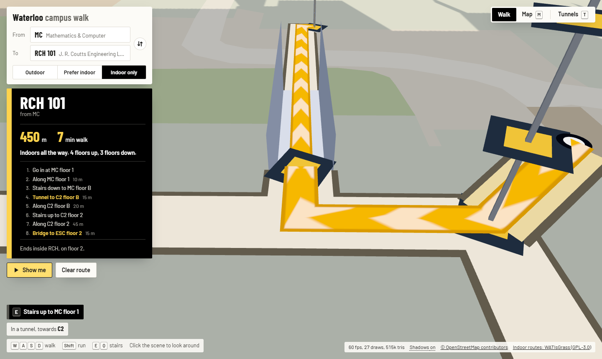 | 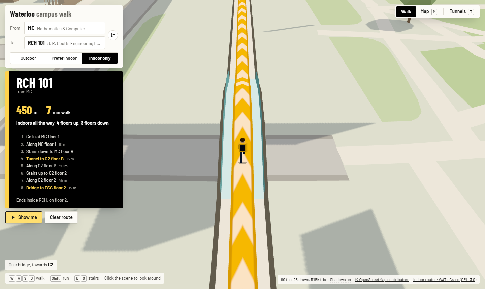 |
| In a tunnel, seen from above ground | Crossing a bridge |
| 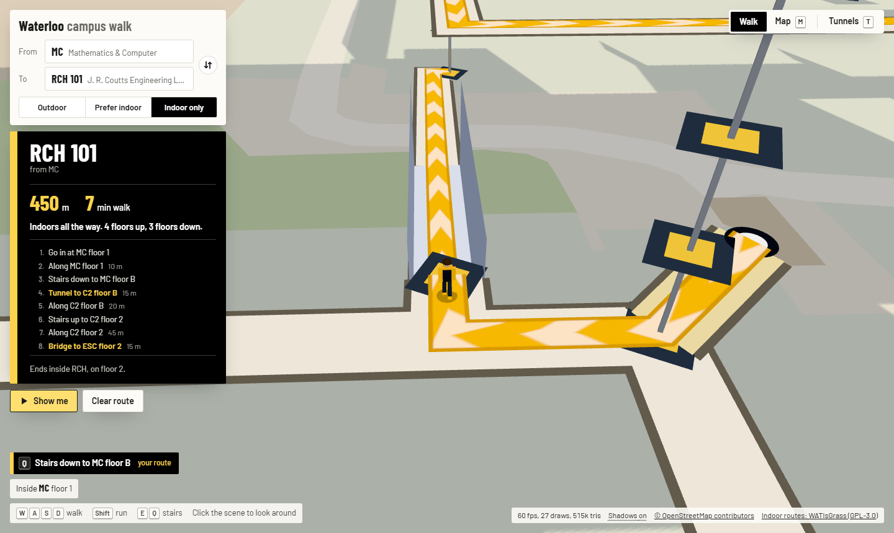 | 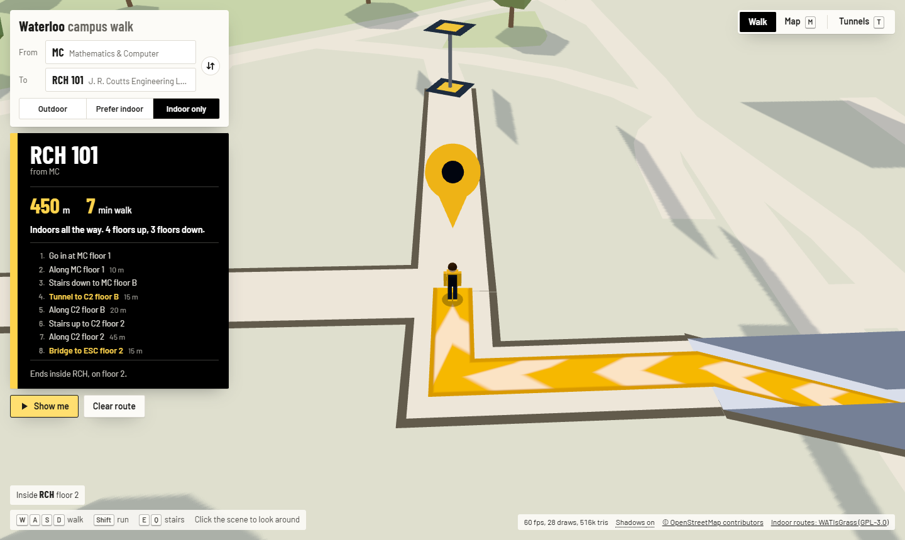 |
| At a stairwell, with the prompt | Arrived inside RCH on foot |
|  | |
| Just inside a door, building cut away | |

## How it works, briefly

Indoors there are no walls to collide with. Each hallway, tunnel, bridge and doorway is a strip: a line with a width and a height at each end. The character must stay within a strip's width, at about its height. That gives corridor edges, floors stacked above each other, ramps into tunnels, and doorways through building walls, all from the network data that was already there. Outdoors nothing changed: wall collision is still Rapier's.

## What was verified, and how

- **78 tests pass**, 9 of them new, on the indoor surface: doorways are the only way in or out, stacked floors are told apart by height, a walker pushing into a hallway's edge slides along it, tunnels are ramps not drops, stairwells offer the right floors, and on the real campus every hallway, tunnel and bridge has a floor under it and every exit has a doorway reachable from outside.
- **Walking in and out of a door with the real keys.** `npm run shots` stands the character outside a doorway, holds `W`, and checks it ends up inside the right building and floor; then holds `S` and checks it is back outside.
- **Walking a whole indoor route.** The same script steers the character from MC to RCH 101 on the Indoor only route, pressing whichever stairs key the app suggests. It checks on every frame that the character is standing on an indoor floor.
- **I looked at the screenshots above.**

Results from the last run:

| Check | Result |
|---|---|
| Walk in through a door (hold `W` from outside a door of OPT) | Ended inside OPT floor 2, as expected |
| Walk back out (hold `S`) | Back on open ground, outdoors |
| Walk MC to RCH 101, Indoor only | Arrived in 71 s, 0.6 m from the route's end, inside RCH floor 2 |
| Along the way | 7 flights of stairs, both tunnels, both bridges, never stuck |
| Standing on a floor | 0 of 3,866 frames off the indoor floors (frames on the stairs excluded) |
| Console errors | None |
| Frame rate | About 60 a second, 28 draw calls |

Not verified: mouse capture (as before, browsers refuse it to scripts), and how it feels to steer by hand through tight corners. Please try a route yourself.

## Known gaps

1. **Hallways are lines with a fixed width,** about 2.8 m, not real rooms. You cannot wander off them, and there are no room doors.
2. **The cutaway is a circle around the character,** not the shape of the building you are in, so neighbouring buildings inside the circle disappear too and the far end of a long building stays solid.
3. **Stairs are a key press.** The data has no stair geometry, so the character is carried between floors.
4. **Some doors sit a floor above or below the ground outside,** an effect of the flat ground and approximate floor heights. You still get in, with a visible hop.
5. **A few hallways and doors do not line up with the building outlines,** because the indoor data and the outlines come from different sources. M3 is one: its mapped hallway point sits outside the OSM footprint.
6. **From above ground, a tunnel looks like an open trench** in the ground. That is deliberate (you can see the character in it), but it is a cutaway, not a realistic tunnel.
7. **"My location" as a route start** still snaps to the nearest outdoor path when you are standing indoors.

## Suggested next steps

1. **Terrain,** which would also fix the floor heights and the doors that sit a floor off the ground.
2. **Room positions** for the main lecture halls, so "RCH 101" ends at the room.
3. **A visual pass on the interiors:** cut away only the building you are in, real steps in stairwells, ceilings on tunnels when the camera is inside.
